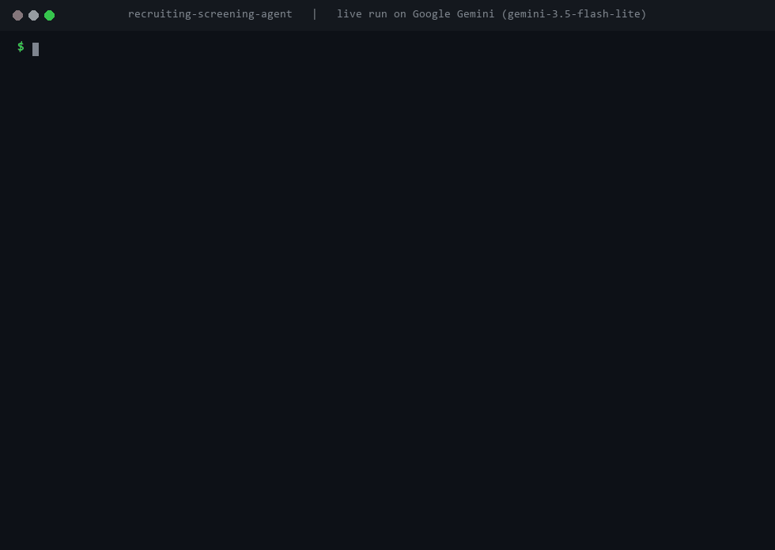

<h1>Resume Screening Agent</h1>

<b>Reads a stack of resumes against a job description and returns a ranked shortlist, with the evidence behind every score.</b>

  
  
  
  
  

  <a href="#what-it-does">What it does</a> &nbsp;|&nbsp;
  <a href="#how-it-works">How it works</a> &nbsp;|&nbsp;
  <a href="#sample-run">Sample run</a> &nbsp;|&nbsp;
  <a href="#quick-start">Quick start</a> &nbsp;|&nbsp;
  <a href="#configuration">Configuration</a> &nbsp;|&nbsp;
  <a href="#roadmap">Roadmap</a>

 

<h2>See it in action</h2>

Recorded in the built-in hiring board from a real run on Google Gemini (<code>gemini-3.5-flash-lite</code>) on 14 November 2026. Nothing is scripted. Only the time spent waiting for the model is fast-forwarded, and the real response times are shown on screen. <a href="demo/demo.mp4">Download the MP4</a>.

Run <code>python app.py</code> and it opens a hiring board with the job post and the fairness rules next to a shortlist that re-ranks itself as each resume is scored. It is the same agent code as the command line version, with a screen on top.

<h2>The problem</h2>

A single job post can bring in hundreds of resumes. Recruiters skim each one for seconds, good candidates get missed, and the reasons behind a rejection are rarely written down.

A score on its own doesn't help. "72" tells a recruiter nothing. "72, four years of relevant Python but no cloud experience" lets them make a decision.

<h2>What it does</h2>

<table>
  <tr><th align="left">Capability</th><th align="left">What that means in practice</th></tr>
  <tr><td><b>Ranked shortlist</b></td><td>Every resume is scored against the job description and the list comes back in order.</td></tr>
  <tr><td><b>Evidence, not just numbers</b></td><td>Each candidate gets specific strengths, specific gaps and a short summary, all tied to what the resume actually says.</td></tr>
  <tr><td><b>Bias safeguards</b></td><td>The prompt rules out age, gender, name, school, employer prestige and graduation year as signals.</td></tr>
  <tr><td><b>Fair to career changers</b></td><td>Relevant personal projects count as real experience. The sample data includes a career changer to test this.</td></tr>
  <tr><td><b>Spreadsheet export</b></td><td>The full results go to <code>output/ranked_candidates.csv</code>.</td></tr>
</table>

<h2>How it works</h2>

<pre>
job_description.txt + resumes/*.txt --&gt; model scores each resume (structured output)
                                                   |
                         ranked shortlist + strengths, gaps and summary --&gt; CSV
</pre>

Each resume is scored separately against the job description. The result comes back as a Pydantic object with the name, score, strengths, gaps and summary, and the score is clamped to 0 to 100.

To screen for a different role, replace <code>data/job_description.txt</code> and the files in <code>data/resumes/</code>.

<h2>Decisions I made on purpose</h2>

<h3>The bias instruction</h3>

A model doesn't need to be told someone's age to be biased against them. Graduation year, a career gap, a bootcamp instead of a degree, or an unfamiliar employer all correlate with things unrelated to the job. Left alone, a model will quietly use them, so the prompt rules them out directly.

Stating it isn't proof, so the sample data tests it. One of the five resumes belongs to a former teacher six months into a career change, with a FastAPI project he built himself and no degree in the field. He should be judged on that work, not on the path he took.

<h3>Built for compliance conversations</h3>

Automated hiring tools are regulated in a growing number of places. The bias approach and the written reasoning are part of the deliverable, not an extra, and I raise them with a client before deployment, not after.

<h2>Sample run</h2>

<pre>
$ python screen_candidates.py
Ranked shortlist:

1. Wei Chen (wei_chen.txt) - 91/100
   Strengths: 6 years leading backend teams on Python/Django and GCP; deep
   Postgres and API design; mentoring experience matches the nice-to-have
   Gaps: Seniority sits well above the mid-level target, likely a level
   or compensation mismatch

2. Maria Lopez (maria_lopez.txt) - 85/100
   Strengths: 4 years production Python and FastAPI; direct Postgres and
   AWS experience; has reviewed code for other engineers
   Gaps: No large-scale system design experience mentioned
</pre>

<h2>Quick start</h2>

You need Python 3.12 or newer and an API key from OpenAI, Anthropic or Google Gemini.

<pre>
pip install -r requirements.txt
cp .env.example .env        # on Windows: copy .env.example .env
# open .env and paste your API key
python app.py               # opens the hiring board at http://localhost:8000
python screen_candidates.py
</pre>

<h2>Configuration</h2>

Everything is set in <code>.env</code>. Copy <code>.env.example</code> to start.

<table>
  <tr><th align="left">Variable</th><th align="left">Required</th><th align="left">Purpose</th></tr>
  <tr><td><code>LLM_MODEL</code></td><td>Yes</td><td>Which model to use, as <code>provider:model</code>. Default <code>openai:gpt-5.5</code>. Also works with <code>anthropic:claude-opus-5-5</code> or <code>google_genai:gemini-3.5-flash</code>.</td></tr>
  <tr><td><code>OPENAI_API_KEY / ANTHROPIC_API_KEY / GOOGLE_API_KEY</code></td><td>One of them</td><td>The key for whichever provider you picked.</td></tr>
</table>

<h2>Project structure</h2>

<pre>
recruiting-screening-agent/
  .env.example             # copy to .env and add your key
  case_study.md            # longer write-up of the design
  README.md
  requirements.txt         # dependencies
  screen_candidates.py     # screens every resume and prints the shortlist
  app.py                 # browser hiring board, the same agent with a UI
  agent/
    llm.py                 # picks the model from LLM_MODEL
    screening.py           # the scoring prompt and bias rules
  data/
    job_description.txt    # the role being hired for
    resumes/               # five sample resumes
  demo/                    # recording of a live run (GIF, MP4 and a screenshot)
  tests/                   # pytest suite, runs without any API key
  web/
    index.html          # the hiring board, one file, no build step
</pre>

<h2>Built with</h2>

Python &nbsp;&middot;&nbsp; LangChain &nbsp;&middot;&nbsp; Pydantic &nbsp;&middot;&nbsp; OpenAI / Anthropic / Gemini

<h2>Tests</h2>

<pre>
pip install -r requirements-dev.txt
pytest
</pre>

Four tests cover loading the job description and resumes, the bias instruction staying in the prompt, and score clamping, plus the browser screen and its API. None of the tests call a model or need an API key, so they run on GitHub Actions on every push. The badge at the top shows the latest result.

<h2>Roadmap</h2>

What I would build next if a client took this into production:

<ul>
  <li>PDF and Word resume parsing</li>
  <li>Pulling candidates straight from an ATS such as Greenhouse, Lever or Workable</li>
  <li>An audit log of every score and its reasoning, in case a decision is ever challenged</li>
  <li>Screening against several open roles at once</li>
</ul>

<h2>More from this series</h2>

Nine production-minded AI agents, each solving one business problem properly.

<table>
  <tr><td><a href="https://github.com/saqib-n/ai-research-report-agent"><b>Research Report Agent</b></a></td><td>Researches a topic, notices its own gaps, and writes a report with a source for every claim.</td></tr>
  <tr><td><a href="https://github.com/saqib-n/ai-sales-outreach-agent"><b>AI Sales Outreach Agent</b></a></td><td>Personalised cold emails and follow-ups, with a human approving every send.</td></tr>
  <tr><td><a href="https://github.com/saqib-n/ecommerce-automation-agent"><b>E-commerce Order and Inventory Agent</b></a></td><td>Shopify order, stock and returns assistant, plus a monitor that warns you before stock runs out.</td></tr>
  <tr><td><a href="https://github.com/saqib-n/email-triage-agent"><b>Email Triage Agent</b></a></td><td>Sorts an inbox into four buckets and gives each one a different level of autonomy.</td></tr>
  <tr><td><a href="https://github.com/saqib-n/lead-qualification-crm-agent"><b>Lead Qualification Agent</b></a></td><td>Scores inbound leads against your own rubric and pushes the good ones to HubSpot.</td></tr>
  <tr><td><a href="https://github.com/saqib-n/multi-agent-customer-support"><b>Multi-Agent Customer Support</b></a></td><td>A router plus specialist agents for orders, refunds, FAQs and human handoff.</td></tr>
  <tr><td><a href="https://github.com/saqib-n/rag-knowledge-base-agent"><b>RAG Knowledge Base Agent</b></a></td><td>Answers questions from your own documents and names the source for every answer.</td></tr>
  <tr><td><a href="https://github.com/saqib-n/whatsapp-support-agent"><b>WhatsApp Support Agent</b></a></td><td>A WhatsApp Cloud API agent that checks orders, answers FAQs and escalates to a person.</td></tr>
</table>

<h2>Work with me</h2>

I'm Saqib Nawaz, founder of WolfXense AI. I build AI agents and automations for businesses, with Python, LangChain, LangGraph and n8n, and connect them to the tools teams already use, like CRMs, Shopify, Slack, email and WhatsApp.

If your hiring team spends days on first-pass screening, I can adapt this to your roles and your ATS, with the fairness and audit pieces built in from the start.

<a href="https://www.upwork.com/freelancers/~01de008504a38baf28"><b>Hire me on Upwork</b></a> &nbsp;|&nbsp; <a href="https://github.com/saqib-n"><b>More of my work on GitHub</b></a>

Released under the <a href="LICENSE">MIT License</a>. A longer write-up of the design is in <a href="case_study.md">case_study.md</a>.

